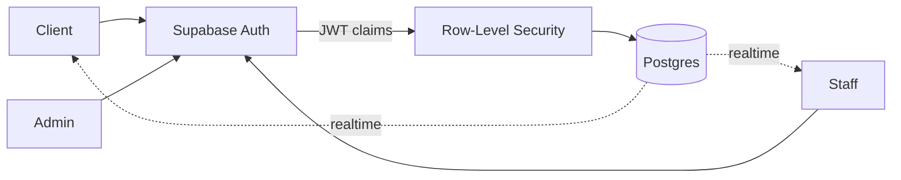

 

 

| 📱 **5K+** installs | 🏢 **3** companies | 🔐 **RLS · JWT** auth | 📴 **Offline-first** |
|:-:|:-:|:-:|:-:|

---

### 🚀 Featured Work
👇 Click any project to expand

<b>💳 Safco eCredit</b> · Live loan-servicing app · <code>5K+ installs</code>

 

> Clients see loans, repayments and history, even offline.

`React Native` `SQLite` `Redux Toolkit` `REST`

- 📴 Offline data layer with API sync
- 🔄 Loan & repayment workflows in production

<b>🏥 QueueLess</b> · Real-time clinic queues · <code>Supabase + RLS</code>

 

> Patients skip the waiting room. Staff and admins run the floor live.

`React Native` `TypeScript` `Supabase` `PostgreSQL`

<b>🍔 FoodApp</b> · Ordering + admin panel · <code>Role-based</code>

 

> Menu → cart → order → admin fulfilment, on local SQLite.

`React Native` `SQLite` `REST`

---

### 🛠️ Stack

+ Zustand · React Query · React Hook Form · Zod · GetX · Claude · Cursor

---

### 💼 Journey

<b>Verge Systems (WebHR)</b> · Software Engineer, React Native · <i>2025 – now</i>

 

Earlier → <b>Algorithms Consulting</b> (RN & Flutter, 2025) · <b>Bidbuyy</b> (Flutter, 2023) 
🎓 B.E. Software Engineering, MUET · 📜 Claude 101 (Anthropic Academy)

---

### 🧭 Next Up

`React Native performance` → `Architecture at scale` → `LLM APIs` → `RAG` → **`AI-powered apps`**

---

<picture>
  <source media="(prefers-color-scheme: dark)" srcset="https://raw.githubusercontent.com/Awais-Chandio/Awais-Chandio/output/github-snake-dark.svg" />
  <source media="(prefers-color-scheme: light)" srcset="https://raw.githubusercontent.com/Awais-Chandio/Awais-Chandio/output/github-snake.svg" />
  
</picture>

 

  

**Open to freelance · Mobile MVPs · AI-powered apps**

