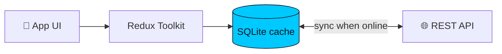
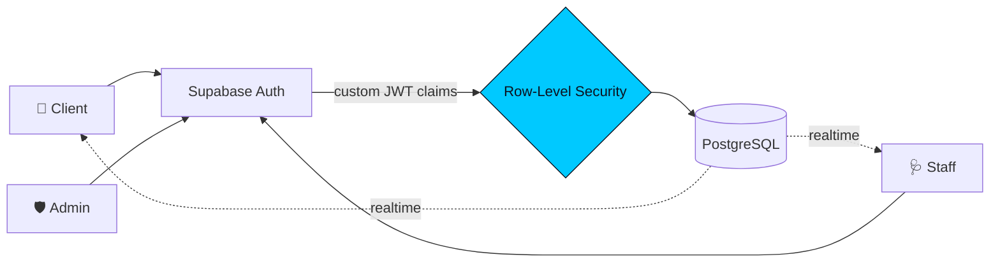
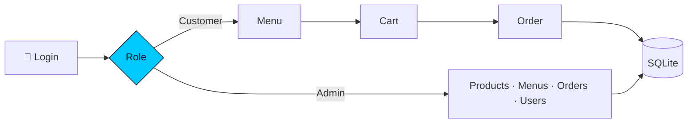
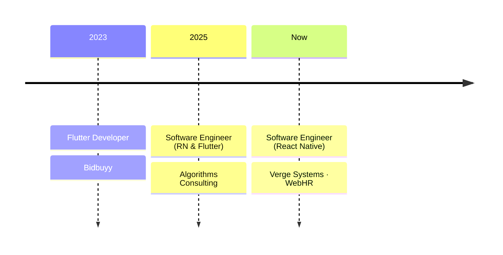
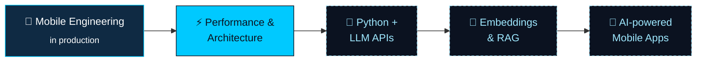

a<!-- ═══════════════════════════ HERO ═══════════════════════════ -->
<div align="center">


<a href="https://awaischandioport-kappa.vercel.app">
  
</a>

<br/>

<a href="https://awaischandioport-kappa.vercel.app"></a>
<a href="https://www.linkedin.com/in/muhammad-awais45"></a>
<a href="mailto:awaischandio827@gmail.com"></a>
<a href="https://play.google.com/store/apps/details?id=com.vergesystems.safco_e_banking"></a>


</div>

<br/>

<!-- ═══════════════════════════ ABOUT (as code) ═══════════════════════════ -->

```typescript
const awais: Engineer = {
  role:       "Software Engineer · React Native & Flutter",
  basedIn:    "Pakistan 🇵🇰 · remote-friendly",
  shipped:    ["Safco eCredit · 5K+ installs", "QueueLess", "FoodApp"],
  superpower: ["Offline-first", "Auth & Row-Level Security", "Real-time", "State architecture"],
  learning:   ["Python", "LLM APIs", "Embeddings", "RAG"],
  openTo:     ["Freelance", "Mobile MVPs", "AI-powered apps"],
  motto:      "Building useful software, one release at a time.",
};
```

<!-- ═══════════════════════════ IMPACT ═══════════════════════════ -->

<div align="center">

| <h2>5K+</h2><sub>installs on Google Play</sub> | <h2>3</h2><sub>role-based app architectures</sub> | <h2>3</h2><sub>companies shipped for</sub> | <h2>2</h2><sub>cross-platform frameworks</sub> |
|:-:|:-:|:-:|:-:|

</div>

---

## 🧭 Choose Your Path

<sub>👇 Click the one that fits you</sub>

<details>
<summary><b>🧑‍💼 &nbsp;I'm hiring</b></summary>
<br/>

- ✅ **Production experience**: a live fintech app with 5,000+ installs
- 🔐 **Security-minded**: Supabase RLS, custom JWT claims, role-based access
- 📴 **Offline-first**: SQLite data layers that sync when the network returns
- 🧠 **Clean architecture**: Redux Toolkit, Zustand, React Query, typed with TypeScript + Zod
- 🤝 **Team-ready**: Agile/Scrum, Git workflows, CI/CD, Play Console releases

<a href="https://www.linkedin.com/in/muhammad-awais45"></a>
</details>

<details>
<summary><b>🚀 &nbsp;I need an app built</b></summary>
<br/>

| What you get | How |
|:--|:--|
| 📱 Android + iOS from one codebase | React Native or Flutter |
| ⚡ Backend without the overhead | Supabase / Firebase with auth & realtime |
| 📴 Works on bad internet | Offline-first local storage + sync |
| 🤖 Smart features | LLM-powered search, chat & automation |

<a href="mailto:awaischandio827@gmail.com?subject=Project%20inquiry"></a>
</details>

<details>
<summary><b>👨‍💻 &nbsp;I'm a fellow developer</b></summary>
<br/>

**Ask me about** → Supabase RLS policies · offline sync strategies · Zustand vs Redux · React Query caching · RN CLI builds

**Let's build together** → open-source mobile tooling, AI + mobile experiments

<a href="https://github.com/Awais-Chandio?tab=repositories"></a>
</details>

---

## 🚀 Featured Projects

<table>
<tr>
<td width="33%" valign="top">

### 💳 Safco eCredit
**Live fintech app**<br/>
<sub>Loans, repayments & history, even offline.</sub>

`5K+ installs` `SQLite` `Redux`

<a href="https://play.google.com/store/apps/details?id=com.vergesystems.safco_e_banking"></a>

</td>
<td width="33%" valign="top">

### 🏥 QueueLess
**Real-time clinic queues**<br/>
<sub>Patients skip the waiting room.</sub>

`Supabase` `RLS` `JWT`

<a href="https://github.com/Awais-Chandio/QueueLess"></a>

</td>
<td width="33%" valign="top">

### 🍔 FoodApp
**Ordering + admin panel**<br/>
<sub>Menu to fulfilment, role-based.</sub>

`SQLite` `REST` `RBAC`

<a href="https://github.com/Awais-Chandio/FoodApp"></a>

</td>
</tr>
</table>

<sub>🔍 Want the engineering details? Expand a deep-dive below.</sub>

<details>
<summary><b>💳 Safco eCredit · deep-dive</b></summary>
<br/>

| | |
|:--|:--|
| 🎯 **Problem** | Microfinance clients need loan info anywhere, including areas with weak connectivity |
| 💡 **Solution** | Offline-capable app showing approved amounts, repayment schedules and loan history |
| 🏆 **Result** | Shipped to production · **5,000+ downloads** on Google Play |
| 🧰 **Stack** | React Native CLI · SQLite · Redux Toolkit · REST APIs |


</details>

<details>
<summary><b>🏥 QueueLess · deep-dive</b></summary>
<br/>

| | |
|:--|:--|
| 🎯 **Problem** | Clinics have crowded waiting rooms and no visibility into queue position |
| 💡 **Solution** | Digital appointments + live queue updates across Client, Staff and Admin roles |
| 🔐 **Security** | Supabase Auth → custom JWT claims → Row-Level Security on every table |
| 🧰 **Stack** | React Native CLI · TypeScript · Supabase · PostgreSQL · Maps |


</details>

<details>
<summary><b>🍔 FoodApp · deep-dive</b></summary>
<br/>

| | |
|:--|:--|
| 🎯 **Problem** | Small food businesses need ordering and back-office in one simple app |
| 💡 **Solution** | Separate Customer and Admin flows: products, menus, orders and users |
| 📴 **Storage** | Offline-capable local SQLite |
| 🧰 **Stack** | React Native CLI · SQLite · REST APIs |


</details>

---

## 🧱 How I Build

<div align="center">

| 📴 **Offline is a feature** | 🔐 **Secure at the data layer** | ⚡ **Real-time by default** | 🧩 **Typed end to end** |
|:-:|:-:|:-:|:-:|
| <sub>Apps should work on a bad network, not just a good one</sub> | <sub>RLS and claims, not just hidden buttons</sub> | <sub>Users see changes the moment they happen</sub> | <sub>TypeScript + Zod catch bugs before users do</sub> |

</div>

---

## 🛠️ Tech Arsenal

<div align="center">

<table>
<tr><td align="center" width="140"><b>📱 Mobile</b></td><td></td></tr>
<tr><td align="center"><b>💻 Languages</b></td><td> </td></tr>
<tr><td align="center"><b>☁️ Backend</b></td><td></td></tr>
<tr><td align="center"><b>🧠 State & Forms</b></td><td>     </td></tr>
<tr><td align="center"><b>🚢 Delivery</b></td><td>  </td></tr>
<tr><td align="center"><b>🤖 AI Workflow</b></td><td>   </td></tr>
</table>

</div>

---

## 💼 Career Journey



<details>
<summary><b>📋 View full experience</b></summary>
<br/>

| Role | Company | Period |
|:--|:--|:-:|
| **Software Engineer, React Native** | Verge Systems (WebHR) | Sep 2025 – Present |
| **Software Engineer, React Native & Flutter** | Algorithms Consulting | Jan 2025 – Aug 2025 |
| **Flutter Developer** | Bidbuyy | Dec 2023 – Jan 2024 |

**🎓 Education:** B.E. Software Engineering, Mehran University of Engineering & Technology (MUET), 2020 – 2024

**📜 Certifications**<br/>


</details>

---

## 🗺️ Where I'm Heading



---

## 📊 GitHub in 3D

<div align="center">

<picture>
  <source media="(prefers-color-scheme: dark)" srcset="./profile-3d-contrib/profile-night-rainbow.svg" />
  <source media="(prefers-color-scheme: light)" srcset="./profile-3d-contrib/profile-green-animate.svg" />
  
</picture>

<br/>


<br/><br/>

<picture>
  <source media="(prefers-color-scheme: dark)" srcset="https://raw.githubusercontent.com/Awais-Chandio/Awais-Chandio/output/github-snake-dark.svg" />
  <source media="(prefers-color-scheme: light)" srcset="https://raw.githubusercontent.com/Awais-Chandio/Awais-Chandio/output/github-snake.svg" />
  
</picture>

</div>

---

## ⚡ Live Activity

<sub>🔄 Auto-updated by GitHub Actions</sub>

<!--START_SECTION:activity-->
<!--END_SECTION:activity-->

---

## ✍️ Guestbook

<sub>Drop a comment and your avatar shows up here automatically 👇</sub>

<a href="https://github.com/Awais-Chandio/Awais-Chandio/issues/1"></a>

<!-- GUESTBOOK:START -->
_Be the first to sign!_
<!-- GUESTBOOK:END -->

---

<!-- ═══════════════════════════ CTA ═══════════════════════════ -->
<div align="center">

### 🤝 Have an idea? Let's ship it.

`React Native` · `Flutter` · `Mobile MVPs` · `Supabase` · `Firebase` · `Offline-first` · `AI-powered Apps`

<br/>

<a href="mailto:awaischandio827@gmail.com?subject=Let's%20build%20something"></a>
<a href="https://www.linkedin.com/in/muhammad-awais45"></a>

<br/><br/>

<i>Building useful software, one release at a time.</i>


</div>
