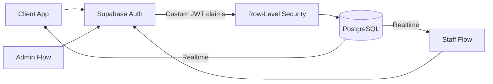
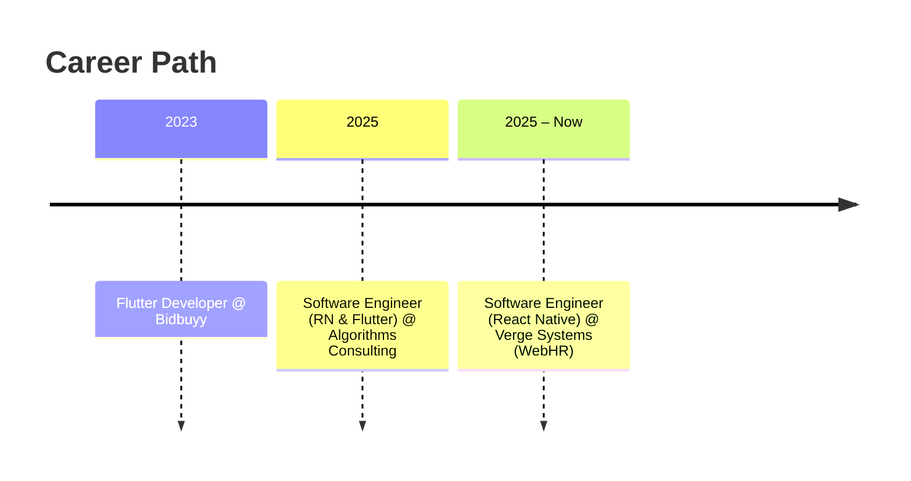

<!-- ===================== HEADER ===================== -->
<div align="center">


<br/>

<a href="https://awaischandioport-kappa.vercel.app"></a>
<a href="https://www.linkedin.com/in/muhammad-awais45"></a>
<a href="mailto:awaischandio827@gmail.com"></a>
<a href="https://play.google.com/store/apps/details?id=com.vergesystems.safco_e_banking"></a>

<br/><br/>


</div>

<br/>

---

## ⚡ At a Glance

<div align="center">

| 📱 **5,000+** | 🏗️ **3** | 🔐 **RLS + JWT** | 🌐 **Offline-first** |
|:---:|:---:|:---:|:---:|
| Downloads on Google Play | Role-based app architectures | Secure, claim-based access control | SQLite-backed data layers |

</div>

---

## 👨‍💻 About Me

I'm a **Software Engineer** who ships **production-ready mobile applications** with **React Native** and **Flutter**: apps that real users install, rely on, and come back to.

My work lives at the intersection of the things that make mobile apps *hard*:

- 🔐 **Authentication & authorization**: role-based access, Row-Level Security, custom JWT claims
- 📴 **Offline-first systems**: SQLite storage, sync strategies, resilient data flows
- ⚡ **Real-time experiences**: live queues, instant updates, Supabase and Firebase backends
- 🧠 **Clean state architecture**: Redux Toolkit, Zustand, React Query
- 🔌 **API integration at scale**: REST workflows, typed contracts, validation with Zod

> 🎯 **Direction:** moving from mobile engineering into **AI application engineering**, bringing LLM capabilities into practical mobile and web products people actually use.

---

## 🚀 Featured Projects

### 🏥 QueueLess
**Real-time queue & appointment management for clinics**

Patients skip the waiting room and join a live digital queue. Staff run the floor, admins run the clinic.

| | |
|:--|:--|
| **Architecture** | Client / Staff / Admin, three roles with separate flows |
| **Realtime** | Live queue position and status updates |
| **Security** | Supabase Auth, Row-Level Security, custom JWT claims |
| **Extras** | Appointment scheduling, map integration |



`React Native CLI` `TypeScript` `Supabase` `PostgreSQL` `RLS` `JWT`

<a href="https://github.com/Awais-Chandio/QueueLess"></a>

<br/>

### 💳 Safco eCredit
**Loan servicing app for Safco Support Foundation · 🟢 Live in production**

Clients check approved loan amounts, repayment schedules and full loan history, even with unreliable connectivity.

| | |
|:--|:--|
| **Scale** | **5,000+ downloads** on Google Play |
| **Data layer** | Offline-capable, SQLite local storage with API synchronization |
| **State** | Redux Toolkit |
| **Domain** | Loan and repayment workflows |

`React Native CLI` `SQLite` `Redux Toolkit` `REST APIs`

<a href="https://play.google.com/store/apps/details?id=com.vergesystems.safco_e_banking"></a>

<br/>

### 🍔 FoodApp
**Food ordering platform with separate customer and admin experiences**

Full ordering lifecycle: menu → cart → order → admin fulfilment, backed by local SQLite storage.

| | |
|:--|:--|
| **Architecture** | Customer / Admin with role-based app flow |
| **Management** | Products, menus, orders and users |
| **Storage** | Offline-capable local SQLite |

`React Native CLI` `SQLite` `REST APIs` `Role-Based Access`

<a href="https://github.com/Awais-Chandio/FoodApp"></a>

---

## 🛠️ Tech Stack

<div align="center">

**Mobile**<br/>


**Languages**<br/>


**Backend & Data**<br/>


**State, Forms & Data Fetching**<br/>


**Engineering & Delivery**<br/>


**AI-Assisted Workflow**<br/>


</div>

---

## 💼 Experience



| Role | Company | Period |
|:--|:--|:-:|
| **Software Engineer, React Native** | Verge Systems (WebHR) | Sep 2025 – Present |
| **Software Engineer, React Native & Flutter** | Algorithms Consulting | Jan 2025 – Aug 2025 |
| **Flutter Developer** | Bidbuyy | Dec 2023 – Jan 2024 |

---

## 🎓 Education & Certifications

**B.E. Software Engineering** · Mehran University of Engineering and Technology (MUET) · *Nov 2020 – Nov 2024*


---

## 🧭 Currently Exploring

```text
 React Native Mastery                      AI Engineering
 ────────────────────                      ──────────────
 ▸ Performance                             ▸ Python
 ▸ App Architecture            ───▶        ▸ LLM APIs
 ▸ Advanced State Management               ▸ Embeddings
 ▸ Offline-first Systems                   ▸ RAG
 ▸ Production Engineering                  ▸ AI-powered Apps
```

---

## 📊 GitHub Activity

<div align="center">


<br/>


</div>

---

## 🤝 Let's Build Something

I take on **freelance and collaboration work** in:

<div align="center">

`React Native` · `Flutter` · `Mobile MVPs` · `Supabase` · `Firebase` · `REST APIs` · `Offline-first Apps` · `AI-powered Apps`

<br/>

<a href="mailto:awaischandio827@gmail.com"></a>
<a href="https://www.linkedin.com/in/muhammad-awais45"></a>

<br/><br/>

*Building useful software, one release at a time.*


</div>
